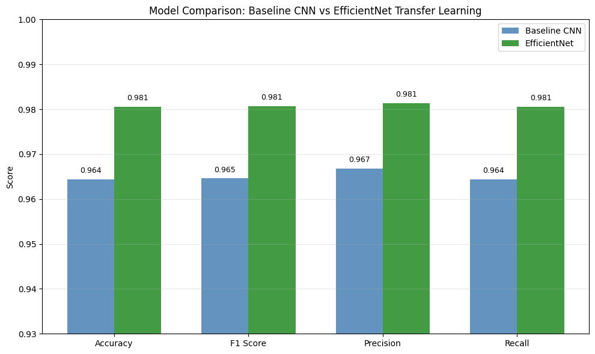
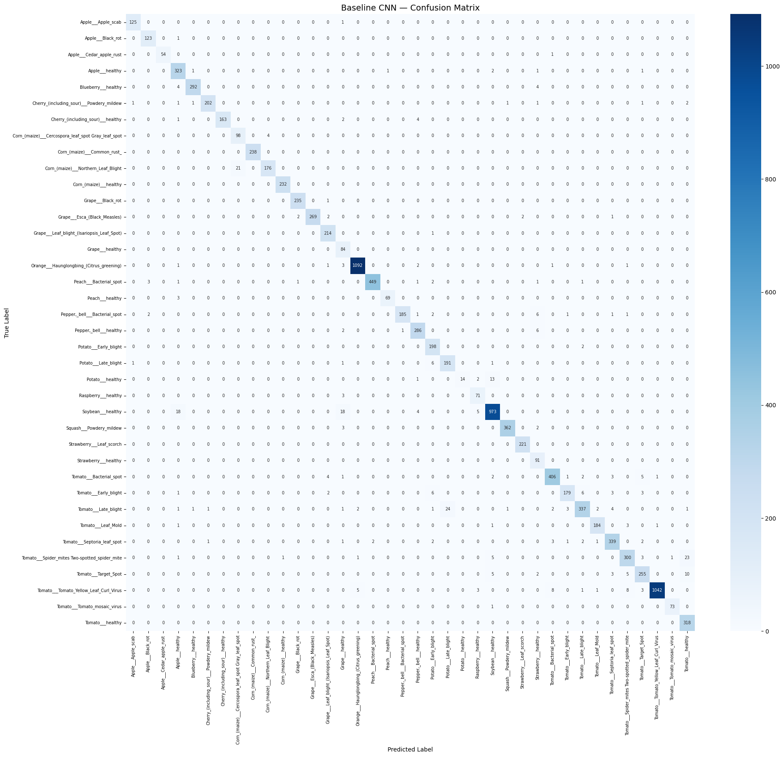
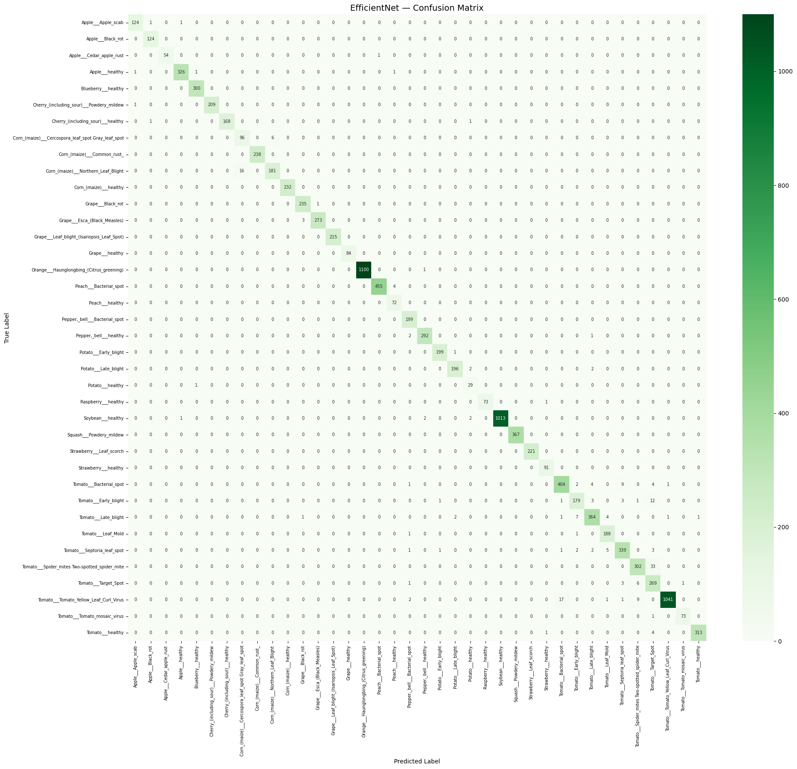
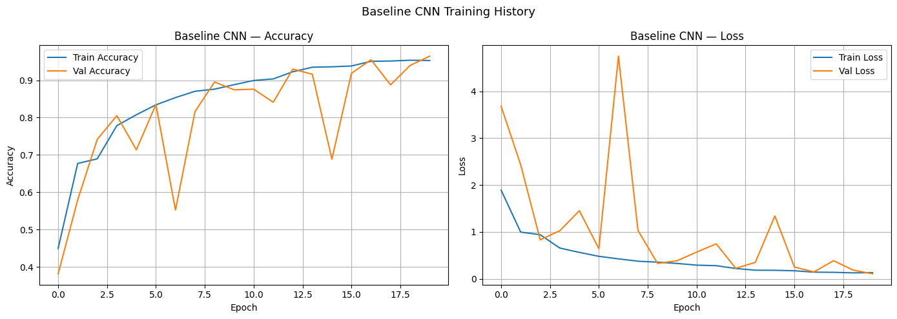
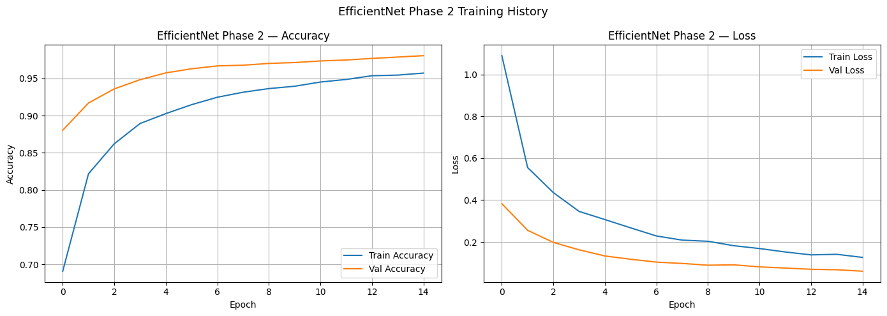
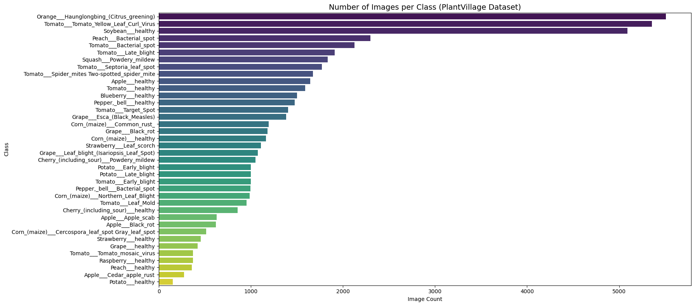
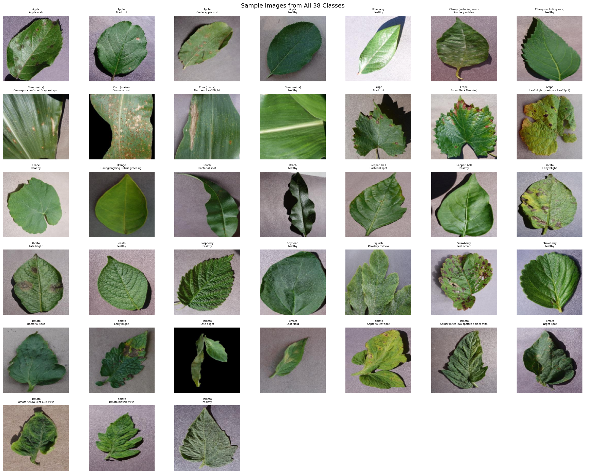
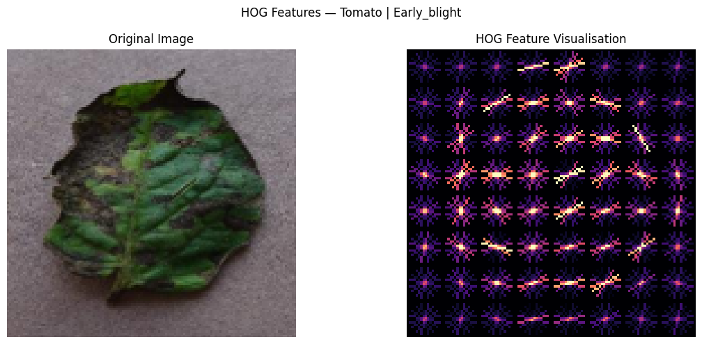
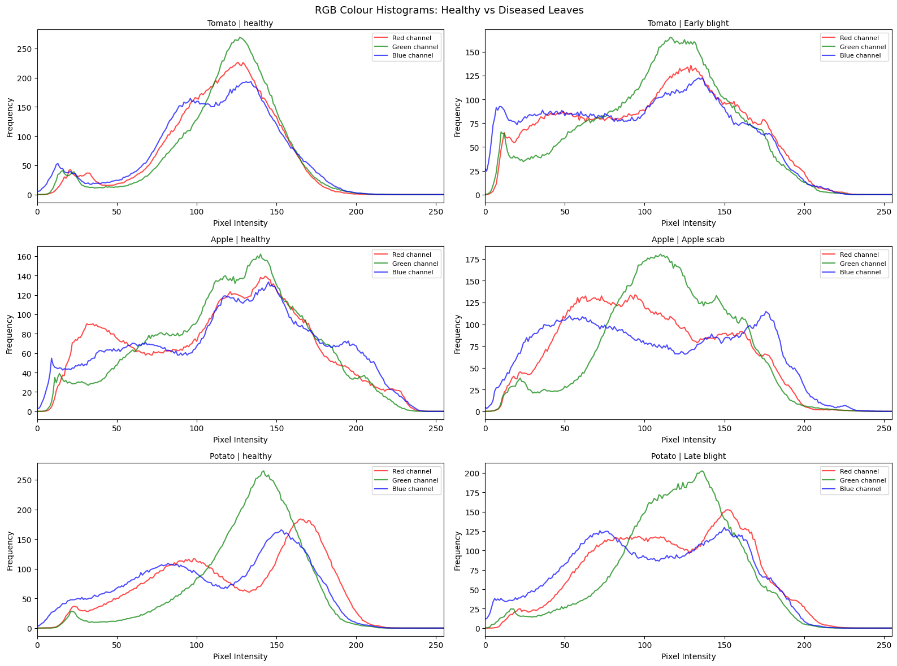
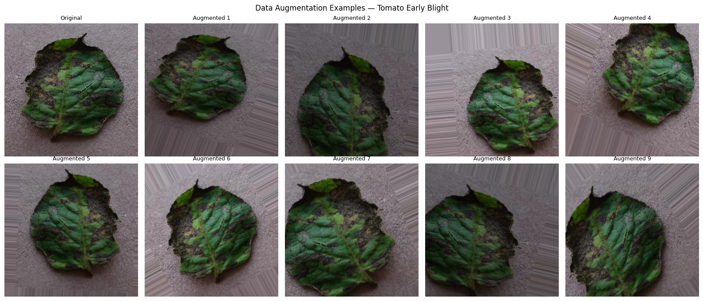

# Plant Leaf Disease Detection

MSc machine learning project (2026).

This project classifies 38 classes of plant leaf images (14 crops, 26 diseases and 12 healthy classes) from the PlantVillage dataset. It compares a CNN trained from scratch with EfficientNetB0 transfer learning.

## Results (test set, 10,849 images)

| Model | Accuracy | Weighted F1 | Macro F1 |
|---|---|---|---|
| Baseline CNN (from scratch) | 96.4% | 0.965 | 0.949 |
| **EfficientNetB0 (transfer learning)** | **98.1%** | **0.981** | **0.976** |



| Baseline CNN confusion matrix | EfficientNet confusion matrix |
|---|---|
|  |  |

| Baseline CNN training history | EfficientNet phase 2 (fine-tuning) |
|---|---|
|  |  |

## Method

- **EDA:** class balance, image properties, pixel intensity and colour channels.
- **Handcrafted features:** HOG and colour histograms, used to see how separable the classes are before any deep learning.
- **Imbalance:** the 7 classes with fewer than 500 images get targeted augmentation.
- **Model 1:** a CNN built and trained from scratch in Keras.
- **Model 2:** EfficientNetB0 pretrained on ImageNet, trained in two phases (frozen base, then fine-tuning).

## Exploratory analysis





| HOG and colour features | Colour histogram comparison |
|---|---|
|  |  |



## Running it

The notebook was run on Kaggle with a GPU. Add the [PlantVillage dataset](https://www.kaggle.com/datasets/abdallahalidev/plantvillage-dataset) to the notebook and it runs as is. To run it elsewhere, set `DATA_DIR` to the `color` folder.

```bash
pip install -r requirements.txt
```

**Tech:** Python, TensorFlow/Keras, scikit-learn, scikit-image, pandas, seaborn
